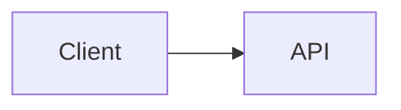

# Writing Markdown for md2html

How to write `.md` that converts well with `md2html`. Read the quick
reference and the silent traps; the rest is detail to look up.
`md2html --guide` prints those two for the binary you have, with an index
of the other sections: `md2html --guide diagrams` prints one of them, and
`md2html --guide all` the whole guide. `md2html --version` names that
binary.

[[toc]]

## Quick reference

The most common needs first. Each row is the form to write; where a
construct has other spellings, they are under
[Choosing between forms](#choosing-between-forms).

| Need | Write |
|---|---|
| Link to another page | `[Setup](./setup.md)`, never `./setup.html` |
| Title, subtitle, date | `# Title` as the first heading; `subtitle:` and `date:` in front matter |
| Contents list | `[[toc]]` alone on a line |
| Note or tip | `> [!NOTE]` on its own line, then `> text` |
| Warning | `> [!WARNING]` on its own line, then `> text` |
| Callout with a title | `::: callout Title` … `:::` (`::: warning Title` for a warning) |
| Collapsible block | `::: details Title` … `:::` |
| Code block with a caption | ```` ```go {caption="server.go"} ```` |
| Diagram | a ```` ```mermaid ```` fence |
| Stable heading anchor | `## Title {#my-id}` |
| Cross-reference to a numbered heading | `§4.2` |
| Status badge | `[draft]`, `[proven]`, `[verified]`, `[designed]`, `[planned]`, `[deprecated]` |
| Any other badge | `[needs review]{.chip}` |
| Aside or worked example | `::: aside Title` or `::: example Title` … `:::` |
| Stat tiles, term grid, titled panel | `::: stats`, `::: defs`, `::: group Title` … `:::` |
| Navigation block | `::: nav {aria-label="Section"}` … `:::` |
| Hand-laid-out figure | a ```` ```fig ```` fence with a YAML body |
| Chart | a ```` ```vega-lite {caption="…"} ```` fence holding a Vega-Lite spec in YAML |
| Chart colour by meaning | `color: {value: "token:status-good"}`, or `-warning`, `-serious`, `-critical`; see [Colours](#colours) |
| Page language | `lang: de` in front matter |
| Page look | `style: claude-artifact` in front matter, or `--style`; `--list-styles` lists them |
| Output for a host that supplies the page (a Claude Artifact) | `--fragment` |

## Silent traps

Each of these gives valid output, a zero exit and no warning. Check for them
before you finish.

1. **A fence inside a fence needs a longer outer fence.** Showing a
   three-backtick block takes four backticks around it, and showing a `:::`
   container inside a container takes `::::` on the outer one. See
   [Nesting fences](#nesting-fences).
2. **An unclosed `:::` container runs to the end of the document**, headings
   and all.
3. **Link to the `.md` source, never the `.html` output.** An `.html` link
   is never matched to the page md2html emits, and when the file exists
   nothing warns. See [Links and images](#links-and-images).
4. **Only the first class names a container's kind.** `::: {.compact
   .warning}` is a plain, unstyled div; write `::: warning {.compact}`.
5. **A container class outside the shipped kinds is unstyled.**
   `::: {.house-style}` is a plain classed div. Only the bare-word form,
   `::: house-style`, warns.
6. **`title:` in front matter sets only the browser tab.** Still write the
   `# Title` heading.
7. **Front matter must be the first bytes of the file and closed by `---`.**
   After a byte order mark, or without the closing line, it renders as body
   text.
8. **`[word]` next to `{…}` becomes a span.** `map[key]{value}` in prose
   renders `map<span>key</span>` and loses `{value}`. Put it in a code span.
9. **A backslash does not escape a status word or `§`.** `\[draft]` is
   still a badge. Put it in a code span.
10. **An unquoted ` #` in a `fig` label starts a comment.** `box: Step #3`
    renders "Step". Other unquoted labels that YAML cannot read fail with a
    warning. See [Quote labels](#quote-labels).
11. **A backtick in a code caption breaks every fence after it.** Use a
    `~~~` fence for that block.
12. **A caption on a `mermaid` fence is dropped.** Caption the diagram in
    prose.
13. **A `|` inside a code span in a table still splits the cell.** Write
    `\|`.
14. **Markdown inside an HTML block needs a blank line before and after
    it.** Without them, `**bold**` stays literal.
15. **`## 4.2. Title` claims no number.** Anything but a space after the
    number, `.`, `)` or `:`, stops `§4.2` from linking to it.
16. **A fragment in a link is never checked.** `./b.md#no-such` passes.
17. **Two explicit `{#same}` ids both stay.** The page then has duplicate
    ids, and links go to the first.
18. **A heading's attribute block needs double-quoted values.** A bare key
    or a single-quoted value, as in `## Setup {#setup data-flag}`, leaves
    the whole block in the heading text, id included. See
    [Headings and anchors](#headings-and-anchors).
19. **An attribute block works only after a heading, link, image or span,
    or on a container or code fence's opening line.** After a paragraph or
    list item, `{.lead}` stays literal text.
20. **A style's light colours set only on `:root`.** The default stylesheet
    also sets them on `:root[data-theme="light"]`, which wins. A page
    switched to light then shows the default's colours. Set each colour on
    `:root[data-theme="light"]` too. See
    [What a style can change](#what-a-style-can-change).
21. **A chart that tells its categories apart only by
    opacity has a weak legend.** Shades of one colour are hard to match to
    their legend entries, more so where overlapping marks add up, and
    hovering the legend highlights nothing. Give each category its own
    colour with a `color` encoding.
22. **A literal colour in a chart's spec doubles its size.** It cannot
    follow the theme, so the chart is drawn twice, once per theme. Use a
    `token:` colour. See [Colours](#colours).

## Page structure

### Front matter

A `---` block at the very top of the file, of flat `key: value` lines:

```markdown
---
title: Rollback runbook
subtitle: What to do when a deploy fails
date: 2026-09-11
lang: en-GB
toc: float
toc-title: Contents
---

# Rollback runbook
```

| Key | Effect |
|---|---|
| `title` | The `<title>`, shown in the browser tab. Nothing on the page. |
| `subtitle` | A `<p class="subtitle">` under the first `<h1>`. |
| `date` | A `<p class="docdate">` under the subtitle. |
| `lang` | The page's `<html lang>`. Overrides `--lang`; default `en`. |
| `toc` | The contents list's layout: `inline`, `float` or `none`. See [Contents list](#contents-list). |
| `toc-title` | The contents list's name for screen readers. Default `Table of Contents`. |
| `style` | The page's styles, stacked in order. Replaces `--style`. See [Styles](#styles). |
| `plugins` | Plugin directories this page's `style:` can draw on, relative to the page. |

`lang` is what screen readers use to pick a voice. A value that is not a
language tag, such as `en_US`, warns and is ignored.

Keys are case-insensitive, a value may be quoted (`title: "Rollback: why"`),
and a repeated key keeps its last value. Any other key does nothing on the
page, but it still travels in the embedded source unless you build with
`--no-source`.

The block must be flat. A nested value, a YAML comment, or a line without a
colon makes the whole block fail to parse, and it renders as body text with
a warning.

Without front matter, an italic line directly under the first `<h1>` becomes
the subtitle. That also happens to an italic line you meant as prose, such
as `*Draft, do not circulate*`; give the page a `subtitle:` or put the
line lower down.

### Title

Write the title as the first `# heading`. The page `<title>` comes from
front matter `title:`, else from that first `<h1>`, else from the file name.

### Headings and anchors

Every heading gets an `id` and a hover anchor link. Slugs follow the rules
GitHub, GitLab and Pandoc share: lower case, punctuation dropped, each space
a hyphen, nothing merged afterwards. `## Sizes: small × large` is
`#sizes-small--large`. Letters and digits from any script are kept, so
`## はじめに` is `#はじめに`; a heading with none gets `section-N`. A repeated
heading is numbered: the second `## Setup` is `#setup-1`. A status badge in
a heading stays out of its slug.

For an anchor that survives rewording, give the heading an explicit id:

```markdown
## Breaking change in v2 {#breaking-v2}
```

A heading's attribute block takes an `id`, classes, and `key="value"`
pairs, with a stricter grammar than a container's. Write every value in
double quotes: `{data-step="1"}`. An unquoted number becomes an empty
value, and a bare key (`{data-flag}`) or a single-quoted value leaves the
whole block, id included, as literal heading text. It takes the common
global attributes (`title`, `lang`, `dir`, `role`, `style`…) and `data-`
names; `aria-` names and event handlers are dropped. An explicit id is
never rewritten, and generated slugs avoid it. GitHub shows the block as
literal text.

An attribute block at the end of a heading line belongs to the heading,
even straight after a link: `## See [docs](./docs.md){.ext}` puts the class
on the `<h2>`.

### Contents list

`[[toc]]` alone in its paragraph becomes a `<nav class="toc">` listing the
page's headings, each linking to its anchor. `[TOC]` works too, in any
case. Depth shows as `›` marks, up to three. Headings inside a `details`, `aside`
or `example` block are listed too, even though the block starts closed.

```markdown
[[toc]]
```

On a long page, `toc: float` in front matter pins the list beside the text
on a wide screen. On a narrow screen and in print it is the inline list
again. `--toc float` does the same for a whole run, and `toc: inline` opts
one page out. Only the first list on a page floats.

A run can add the list itself. `--autotoc all` gives every page without a
marker one, and `--autotoc long` only pages over 1000 lines or five
headings. It goes under the title, subtitle and date, and floats unless
`--toc` or the page's `toc:` says otherwise. `toc: none` opts one page out.

Things that leave no list:

- `toc: float` or `toc: inline` without a marker, unless `--autotoc` adds
  a list. Front matter warns; `--toc float` does not.
- A marker inside a code span or a link, or sharing its paragraph with
  other text. It stays literal.
- A page with no headings, or built with `--no-anchors`. The marker stays
  as literal text.
- GitLab's `[[_TOC_]]`, which is not recognized.

## Links and images

**Link to the `.md` file.** md2html rewrites it to the page it emits and
works out the relative path:

```markdown
[Auth](./api/auth.md)          -> href="api/auth.html"
[Setup](./api/auth.md#setup)   -> href="api/auth.html#setup"
```

Reference-style links are rewritten the same way. `.md` and `.markdown` are
document extensions; every other file is an asset.

- **A link to a missing `.md` warns** and is left as written.
- **An `.html` link is an asset link, not a page link.** If the file is
  missing it warns; if it exists, `-o` points the link back at the source
  tree. It is never matched to the page md2html emits.
- **A link starting with `/` is a filesystem path**, not a site path, so it
  usually warns that the target does not exist. Use relative links.
- **A link to a directory** points at the directory, not at an index page
  inside it. Link the file.
- **A query string on a document link is dropped.** `./b.md?v=2` becomes
  `b.html`. Fragments are kept.
- **Links inside code are inert.** A fenced example containing
  `[a](./nope.md)` is not followed and does not warn.

**Assets are linked, not copied.** With `-o`, an image link is rewritten to
point back at the original file, so moving the output tree on its own
breaks images. Without `-o`, each page sits beside its source and links are
left as written. `` and Markdown images are rewritten and checked;
`srcset`, `<video poster>`, `<track src>` and `<object data>` are not.

**A link or image can carry attributes.** Write a `{#id .class key=value}`
block straight after it, with no space (Pandoc's `link_attributes`):

```markdown
[Intro](./intro.md){aria-current=page}   -> <a href="intro.html" aria-current="page">
{width=50% .wide}   -> 
```

It takes the global attributes, some of the element's own (`target`,
`rel`, `download`, `referrerpolicy` on a link; `width`, `height`,
`loading`, `decoding`, `sizes` on an image), and any `data-` or `aria-`
name. `hreflang` and `type` are among those dropped. Anything else, such as an event handler, is
dropped. `href`, `src` and `srcset` warn: write the target in the link. A
block with a space before it, with nothing in it, or with something that is
not an attribute name (`{{version}}`) stays as literal text.

Off-site links get `target="_blank" rel="noopener noreferrer"`, added to
any `rel` you wrote.

## Callouts and containers

### Alerts

Use GitHub's alert syntax for a note or a warning. It renders natively on
GitHub, Obsidian and Typora, and as a blockquote everywhere else.

```markdown
> [!WARNING]
> This overwrites state.
```

`NOTE`, `TIP` and `IMPORTANT` render as a `callout`; `WARNING` and
`CAUTION` as a warning callout. The marker must be upper case and alone on
its line: `[!note]`, `[!HINT]` and `> [!NOTE] Title` stay ordinary
blockquotes. The box shows no "Note" or "Warning" label, as GitHub does, so
do not write text that relies on one. An alert takes no title, id or class;
use a container when you need one.

### Containers

A container is a block between `:::` fences. Write the kind after the
opening fence, then an optional title, then an optional attribute block:

```markdown
::: warning Before you migrate
Back up the database first.
:::

::: aside Why this matters {#why .compact}
Because.
:::
```

The space after `:::` is optional. The opening fence needs a kind or an
attribute block: `:::` alone is literal text, and so is the closing line of
a container that was never opened.

| Kind | Element | Use it for |
|---|---|---|
| `callout` | `<div class="callout">` | A highlighted note that needs a title, id or class |
| `warning` | `<div class="callout callout-warning">` | The same, for a warning |
| `card` | `<div class="card">` | A bordered panel for a self-contained item |
| `details` | `<details class="container">` | Content the reader expands on demand |
| `aside` | `<details class="container aside">` | A tangent, collapsed by default |
| `example` | `<details class="container example">` | A worked example; its summary reads "Example — Title" |
| `stats` | `<div class="stats">` | A row of stat tiles |
| `defs` | `<div class="defs">` | A term/definition grid |
| `group` | `<div class="group">` | A titled panel |
| `nav` | `<nav>` | A navigation landmark; adds no class |
| `wide` | `<div class="wide">` | A table, code block or card too wide for the text column |

`details` with no title shows "Details"; `aside` with none shows "Aside".

**Other spellings.** Pandoc's braced form, `::: {.warning #id}`, and the
directive form, `:::aside[Title]{#id}`, both work. Use the braced form,
with no title, only in a file that Pandoc also reads; every titled form
breaks there. Use the directive form when a title ends in something shaped
like `{…}`: in any other form a trailing brace group is read as
attributes, so `::: card The {x}` is titled "The".

**Only the first class names the kind.** In the braced form,
`{.warning .compact}` is a warning, but `{.compact .warning}` is a plain
`<div class="compact warning">`, unstyled, with no warning. Put the kind
first, or outside the braces.

**Unknown kinds.** `::: house-style` warns and emits an unclassed `<div>`,
with the title kept as a plain paragraph. `::: {.house-style}` emits a
classed, unstyled `<div>` without a warning, as a hook for a stylesheet you
supply. `::: {#only-an-id}` is an unclassed `<div>`.

**Attributes.** The block takes an id, classes, the global attributes and
any `data-` or `aria-` name, case-insensitively. Anything else, such as an
event handler, is dropped, as is any name starting `data-fence`, which md2html
reserves. A bare key (`{data-flag}`) and a single-quoted value work.
Classes merge with the kind's own.

**Nesting.** Containers nest. An inner `:::` closes the nearest open
container, so a container whose body shows `:::` source, inside a code
block or not, needs a longer outer fence:

````markdown
:::: example Writing a callout
```markdown
::: callout
Text.
:::
```
::::
````

### stats, defs and group

`stats` and `defs` hold a definition list. In `stats` each term is a
tile's value, its first definition the label, and an optional second
definition a detail line. Either one without a definition list warns.

```markdown
::: stats
99.9%
: uptime
: over the last 90 days

4
: regions
:::

::: defs
fence
: a line of colons
:::

::: group Ingest
Parse each file, then validate it.
:::
```

These look the same as the `fig` items of the same names. Use the container
unless the item sits inside a diagram: its entries are ordinary Markdown,
and the source stays readable on GitHub, which shows them as plain lines.

A plain definition list, with no container, is already styled as a list of
terms. Use `::: defs` when you want the terms and definitions laid out as a
grid.

### nav

`::: nav` makes a `<nav>` landmark. Name it with `aria-label`, since the
contents list is already a `<nav>` and screen readers need to tell them
apart. Mark the current page on its link:

```markdown
::: nav {aria-label="Section contents"}
- [One](./one.md){aria-current=page}
- [Two](./two.md)
:::
```

### Collapsible blocks read on GitHub

`::: details` shows on GitHub as literal text with its body always open.
For a file read there too, write the HTML, with a blank line after
`<summary>` and before `</details>` so the body stays Markdown:

```markdown
<details class="container">
<summary>Title</summary>

Body in **Markdown**.

</details>
```

It renders here exactly as `::: details` does. Without the `container`
class it is unstyled.

## Code blocks

### Nesting fences

A fence closes at the first line with at least as many backticks as it
opened with.
To show a three-backtick block, open the outer fence with four:

`````markdown
````markdown
```go
func main() {}
```
````
`````

Get this wrong and the example ends early, the rest becomes body text, and
nothing warns. A `~~~` fence avoids the question for code that contains
backticks.

### Captions

A `caption` in a fence's attribute block adds a caption bar and wraps the
block in a `<figure class="code-figure">`:

````markdown
```go {caption="server.go"}
func main() {}
```
````

Write the language first and the braced block after it. GitHub reads the
first word as the language and still highlights the block, Pandoc reads the
caption, and `\"` inside the value is a literal quote.

The caption is plain text apart from status badges and `§` references,
which render as they do in prose; `*emphasis*` and links stay literal. A
backtick in a caption is invalid on a backtick fence and breaks every fence
after it; use `~~~` for that block. An `id` reaches the `<pre>` and further
classes reach the `<code>`. Other keys, including `title=`, are ignored.

Two other spellings work: brace-free, ```` ```go caption="server.go" ````,
which cannot escape a quote, and fully braced, ```` ```{.go caption="x"} ````,
which GitHub does not highlight.

## Diagrams

### Mermaid

````markdown

````

A page with a diagram loads a pinned MermaidJS build from a CDN, coloured
from the page's style in light and dark mode: its background, text,
accent, rule, muted and warning colours. `--fragment` output loads nothing,
and leaves the diagram to a host that renders mermaid itself, as a Claude
Artifact does. The fence must be spelled ```` ```mermaid ````:
```` ```{.mermaid} ```` is an ordinary code block, and a `caption=` on a
mermaid fence is dropped. Click a diagram to expand it.

Use mermaid for graphs, sequences and flowcharts. Use a `fig` fence when
you need to place things yourself: panels side by side, stat tiles beside
boxes, a file tree.

### Structured figures

A ```` ```fig ```` fence is a figure you lay out yourself, written as YAML.
The examples below are in `yaml` fences so they show as source; in a real
document they go in a `fig` fence.

```yaml
caption: Request path
items:
  - box: Client
  - arrow: HTTP POST
  - group: Server
    items:
      - box: "`auth` middleware"
      - result: 200 OK
```

#### Quote labels

Labels take inline Markdown (code spans, emphasis, links, badges, `§`
references) only when YAML reads them as a string. Quote a label that:

- starts with `` ` ``, `*`, `[`, `{`, `&`, `!`, `%`, `@`, `|` or `>`
- contains `: ` or ` #`

Unquoted, the first group fails to parse and the figure renders as a code
block with a YAML error, and ` #` starts a comment, so `box: Step #3 of 4`
silently renders "Step". An unquoted `null` or `~` is no value.

#### Kinds

Every item is exactly one kind:

| Kind | Value | What it is |
|---|---|---|
| `box` | label | a labeled box |
| `arrow` | label, may be `""` | a connector; blank is decorative |
| `result` | label | an emphasized outcome bar |
| `rail` | label | a full-width accent rail |
| `stats` | list of `value`/`label`, plus optional `detail` | a row of stat tiles |
| `defs` | list of `term`/`def` | a term/definition grid |
| `group` | title, plus `items` | a labeled panel |
| `chain` | list of items | steps connected in sequence |
| `lanes` | list of lists | parallel stacks |
| `tree` | an indented block | a file or config hierarchy |
| `cols` | list of items | items side by side |
| `split` | list of exactly 2 items | two panels either side of a `boundary` |

A blank box is `box: ""`; a bare `box:` names no kind and is an error.

#### Modifiers

| Modifier | On | What it does |
|---|---|---|
| `note` | `box`, `result`, `rail`, `group` | a quieter gloss beside the label |
| `accent` | `box`, `result`, `rail`, `group` | marks the item out from its siblings |
| `foot` | `group` | a line below the group's items |
| `boundary` | `split` | the label between the two panels |
| `weight` | a child of a `cols` layout or `cols` item | its share of the width, 1–12 |
| `items` | `group` | the group's contents |

A modifier anywhere else is an error. A panel that needs a title, an accent
or a footnote holds a `group`.

#### Layout

The top-level `layout` is `rows` (the default), `cols` or `split`. `cols`
and `split` are also item kinds, so a layout can sit anywhere an item can:

```yaml
items:
  - rail: A request crosses one trust boundary
  - split:
      - group: Client
        items: [{box: Browser}]
      - group: Server
        items: [{box: Handler}]
    boundary: TLS
  - result: The response is signed
```

A figure whose only item is a `cols` or `split` item is an error; write
`layout: cols` or `layout: split` instead. Every panel draws a card,
except one holding an arrow.

`wide: true` at the top level lets the figure extend past the text column.
It has no effect inside a container, or in `--fragment` output that its
host places inside a box of its own rather than directly in `<body>`.

#### Trees

A `tree` is an indented listing, one node per line:

```yaml
items:
  - tree: |
      src/
        * main.go -- the entry point
        util.go
      - vendor/ -- not ours
```

Indent with spaces; a tab is an error. ` -- ` splits a label from its note,
a leading `* ` accents a line and `- ` mutes it. Each needs its spaces, so
`*_test.go` stays literal; escape one with a backslash (`\--`) to keep it.

#### Faults

A figure that does not parse or validate renders as a code block and warns,
naming the item and the fault. Line numbers count from the first line of
the fence body. The figure's caption is the `caption:` key; `caption=` on
the fence line warns.

## Charts

A ```` ```vega-lite ```` fence is a chart, drawn when md2html builds the
page. Its body is a Vega-Lite spec, in YAML or in JSON, which YAML also
reads. The [Vega-Lite documentation](https://vega.github.io/vega-lite/docs/)
describes the grammar: marks, encodings, scales and transforms.

````markdown
```vega-lite {caption="Median response time by region"}
data:
  values:
    - {region: North, ms: 182}
    - {region: South, ms: 240}
    - {region: East, ms: 205}
    - {region: West, ms: 167}
mark: bar
encoding:
  y: {field: region, type: nominal, sort: null}
  x: {field: ms, type: quantitative, title: Milliseconds}
  tooltip: {field: ms}
```
````

The chart is SVG in the page, in the style's colours and face, and follows
the reader's light or dark theme. The page gains no script and fetches
nothing for it, and `--fragment` output carries it the same way.

The caption goes in the info string, as on a code block, and sits under
the chart. Classes there, such as `{.wide caption="…"}`, go on the
chart's `<figure>` after its own `md2html-chart`. The body is Vega-Lite's
alone: md2html adds no keys to it, and a spec's own `title` still draws
inside the chart.

A spec that does not parse, compile or render warns, naming the fence by
its number on the page, and shows as a code block of its source; see
[Warnings](#warnings).
`--no-charts` leaves every `vega-lite` fence as a code block, as does
`Options.NoCharts` in the library.

### Data

`data: {values: […]}` holds the data in the spec.
`data: {url: ./results.csv}` reads a CSV, TSV or JSON file when the page
is built, relative to the page's source. The file must stay inside the
run's base: for the command, the common ancestor of its entry points; in
the library, `Options.DataRoot`, or the page's own directory when that is
empty. A `Convert` call with no `SourcePath` reads no files.
A `url` with a scheme or host is refused: md2html never fetches. So is
one with a query or a fragment, such as `results.csv?v=2`, since a file
has neither. The data is fixed when the page is built, so rebuild the
page to update a chart.

Dates show the same on every machine that builds the page. There is no
time-zone setting; the rule is:

- A value with no zone shows exactly as written. `2024-01-01` is 1
  January, and `2024-01-01T09:30` is 09:30.
- A value that names an instant shows in UTC. `2024-01-01T09:30+02:00`
  shows as 07:30, and an epoch number, in milliseconds, as its UTC time.

An `image` mark draws only a `data:` URL. Any other `url` would make the
page fetch the image, so the chart is refused.

### Colours

A colour written as `token:<name>` is the style's colour for that role,
and follows the theme. `token:status-critical` marks a value as critical:

```yaml
mark: {type: bar, color: "token:status-critical"}
```

| Token | Use |
|---|---|
| `series-1` … `series-8` | Categories, in this order; a `color` encoding takes them unless its scale names others |
| `status-good`, `status-warning`, `status-serious`, `status-critical` | Status meanings only, never a series |
| `chart-surface` | The surface a chart sits on, which rings and gaps between marks show |
| `chart-grid`, `chart-axis` | Gridlines, and the axis or baseline |
| `fg`, `muted` | Chart text, as on the page |

A name outside this list warns. `token:` is read only in the spec's
settings, never in its data: a data value that reads `token:fg` stays text.
Colours of the form `#0a0bNN` are reserved: md2html draws each token in
one while it builds a chart, so a spec that names one warns and gets that
token's colour.

A literal colour, such as `"#1f5fa8"`, cannot follow the theme, so the
chart is drawn twice, once in each theme's colours, and the page shows the
copy that matches. That doubles the chart's size. For a lighter step of a
colour, keep the token and set `opacity`, but tell categories apart by
colour, not by opacity alone.

### Width

A chart is laid out at its style's chart width, 640 pixels in both built-in
styles, unless the spec sets `width`. A spec that places views side by side
(`hconcat`, `facet` and the like) gets no width from the style.
`width: container` takes the style's width too, since a build has no
container to measure, and `height: container` is Vega-Lite's default
height, as if the spec set none. The chart scales down with its column
and never makes the page scroll sideways; its text scales with it, so a
wide chart on a phone has small text.

### The table view

Under each chart, a collapsed block titled with the caption, or "Chart
data" without one, holds the data the chart drew as a table: one row per
datum each mark drew, one column per field the spec encodes, in encoding
order. A field a transform makes, such as a `fold`'s `key` and `value` or
a `calculate`, is there as the chart drew it. An aggregate's column takes
the name Vega-Lite gives it, such as `sum_v`, and a count's is `count`.
A `timeUnit`'s column does too, such as `yearmonth_date`, and holds the
value the chart drew: the date cut to that unit, so `2024-03-17` under
`yearmonth` is written `2024-03-01`. A unit with no year, such as
`month`, puts every date in 2012, as Vega-Lite does: `2012-03-01`. A
layer drawn from the same data as an earlier one adds no rows, nor do a
line's points, however many series it has. A layer that draws other
rows, such as a rule at a mean, adds its own, with blanks in the columns
it does not encode. Values are as the data holds them, not as the axis
formats them; a date is written in ISO form, `2024-01-01`, or
`2024-01-01T09:30:00Z` with a time. The table is there for a reader who
cannot see the chart, and for one whose browser cannot show the hover
boxes.

### Hover

- **Tooltips.** Each mark a `tooltip` encoding covers gets a box, shown
  above the mark while it is hovered. Where there is no room the box flips
  below, and it shifts sideways to stay inside the chart. A line or an
  area is one shape for all its data, so each of its data points gets a
  box instead, above the point, shown by its nearest-point region.
- **Nearest point.** On a chart whose tooltip marks are all points, lines
  and areas, hovering anywhere nearer one point, or one data point of a
  line or an area, than any other shows that point's box, up to 500
  points. A line or an area with a tooltip beside a tooltip mark of
  another kind, such as a bar, or in a chart of several views, such as a
  `concat` or a `facet`, gets no regions, so its boxes never show and the
  build warns; give the line `point: true`, and its points carry the
  boxes.
- **Keyboard.** Tab reaches each mark with a tooltip, and focus shows its
  box. A chart with more than 50 such marks is one tab stop instead, and
  its table view holds the values. The data points of a line or an area
  are not tab stops, since no element of the chart is theirs; the table
  view holds their values.
- **Legend.** Hovering or focusing an entry of a colour legend dims the
  marks of every other series.

The box sits at one place per mark: it does not follow the cursor, so on a
long bar it is at the bar's centre. There is no zoom, pan, brushing or
click-to-filter, and no live data. The boxes need CSS `:has()`, in every
major browser since late 2023; without it a chart shows no boxes and is
otherwise unchanged.

### Credits

Charts are drawn by Vega and Vega-Lite, from the University of Washington
Interactive Data Lab, which md2html embeds under their BSD 3-Clause
licence. md2html is not affiliated with or endorsed by their authors.
`md2html --licenses` prints the licences of everything md2html embeds.
`md2html --guide styles` covers how a style sets a chart's colours, face
and width.

## Inline marks

### Status badges and spans

Six lowercase words in brackets become badges, in prose or a heading:

```markdown
[proven] [verified] [designed] [planned] [draft] [deprecated]
```

`[proven]` renders `<span class="chip chip-proven">proven</span>`.
`[Proven]` stays literal.

Any other badge uses Pandoc's bracketed span syntax with the `chip` class:

```markdown
[needs review]{.chip}      ->  <span class="chip">needs review</span>
[shipped]{.chip .chip-ok}  ->  <span class="chip chip-ok">shipped</span>
```

A chip takes a tone: `.chip-ok` and `.chip-warn` use the status colours of
`[proven]` and `[deprecated]`, and `.chip-info` the accent. Without one it
is neutral.

The span syntax takes any class: `[lead in]{.lead}` is a
`<span class="lead">`, unstyled unless your stylesheet names it. The label
must be plain text, since `[**x**]{.chip}` stays literal, and only classes
and an id are kept.

A badge stays literal inside a code span, a code block or a link's text.
A backslash does not stop it, so write `` `[draft]` `` to show the word.
`[c:label]` also makes a badge, up to 60 characters.

### Section cross-references

`§4.2` links to the heading whose text begins with `4.2` followed by a
space or the end of the heading. `§ 4.2` works too.

```markdown
## 4.2 Rollback

See §4.2 for details.   ->   <a class="xref" href="#42-rollback">§4.2</a>
```

Number headings `4.2`, not `4.2.`: any other character after the number
means the heading claims none. When two headings claim one number, the
first wins. A number no heading claims stays as plain text.

A possessive naming another document, "the design doc's §7", stays literal.
So does a `§` in a code span. A backslash does not stop it. `--no-anchors`
turns cross-references off along with anchors.

Use `§` when your headings are numbered. Otherwise link the heading's
anchor: `[Rollback](#rollback)`.

## Other Markdown

### Tables

GitHub tables. Each is wrapped in a horizontal scroll container, so do not
wrap one yourself. A `|` inside a code span in a cell still splits the
cell; write `\|`.

```markdown
| Option | Default |
|---|---|
| `--depth` | unlimited |
```

A table is as wide as the text column, and scrolls when it needs more.
To give one more room, wrap it in a `wide` container, which extends past
the column the way a [wide figure](#layout) does, with the same limits:
it has no effect inside another container, or in `--fragment` output that
its host places inside a box of its own. The same works for a code block;
`{.wide}` on the fence itself classes the `<code>`, not the block.

```markdown
::: wide
| Option | Default | Notes |
|---|---|---|
| `--link-depth` | unlimited | … |
:::
```

### Footnotes, definition lists, task lists

```markdown
Claim needing support.[^src]

[^src]: The source.

Term
: The definition.

- [ ] not done
- [x] done
```

All three render. Definition lists are styled; footnotes and task-list
checkboxes are plain HTML.

Also available: `~~strikethrough~~` (a single `~` pair strikes too, so
`H~2~O` is struck), autolinked bare URLs, and the rest of GitHub Flavored
Markdown. Not supported: math, `==highlight==`, `^superscript^` and
`:emoji:` codes, which stay literal.

### Raw HTML

Raw HTML passes through, including `<style>`, `<script>` and inline `<svg>`.
Use it only when Markdown cannot express the thing. Leave a blank line
between an HTML tag and Markdown inside it, or the Markdown stays literal:

```markdown
<div class="card">

**Bold**, as Markdown.

</div>
```

HTML comments stay in the page, and in its embedded source.

Images and inline SVGs that are scaled down to fit the text open full size
when clicked.

## Choosing between forms

Where a construct has several spellings, write the default:

- **Note or warning:** an alert, `> [!NOTE]` or `> [!WARNING]`. Use
  `::: callout Title` or `::: warning Title` only for a title, id or class.
- **Container:** `::: kind Title {#id .class}`. Braced `::: {.kind}`, with
  no title, only for a file Pandoc also reads; `:::kind[Title]{…}` only when
  a title ends in braces.
- **Collapsible:** `::: details`. `aside` for a tangent, `example` for a
  worked example, and the raw `<details class="container">` for a file read
  on GitHub.
- **Code caption:** ```` ```go {caption="x"} ````.
- **Badge:** `[draft]` for the six status words, `[label]{.chip}` for any
  other.
- **Contents list:** `[[toc]]`. `[TOC]` in a file read on GitLab, which
  builds its own list from it; GitHub shows either as literal text. Prefer
  a marker to relying on `--autotoc`, so the page places its own list.
- **Title, subtitle, date:** front matter for subtitle and date, a
  `# Title` heading for the title.
- **Reference:** `§4.2` for numbered headings, `[text](#anchor)` otherwise.
- **Diagram:** mermaid, or `fig` when you need to place things yourself.
  A chart of data is a `vega-lite` fence.
- **Stat tiles, term grid, panel:** the container, unless the item sits in
  a `fig` diagram.

Forms mix freely within a document.

## Build behaviour

### What conversion adds

- an `id` and a hover anchor on every heading
- a horizontal scroll wrapper around every table
- `target="_blank" rel="noopener noreferrer"` on off-site links
- `.md` links rewritten to `.html`, and asset links pointed back at the
  source
- a `<title>`, from front matter, the first `<h1>`, or the file name
- the Markdown source, hidden at the end of the page with Copy and Download
  controls

Flags turn each off: `--no-anchors` (which also turns off the contents list
and `§` references), `--no-table-scroll`, `--no-external-links`,
`--no-md-links`, `--no-assets` and `--no-source`.

### Following links

Every `.md` a page links to is converted too, however far away it is, and
the run reports how many it pulled in from outside the entry points.
`--depth` limits how deep directories are scanned, not how far links are
followed; `--link-depth` limits link hops. Several entry points
(`md2html -o site ./docs ./notes`) build as one set, with links between
them rewritten.

Without `-o`, each page is written beside its source, and a link that
leaves the entry tree is refused with a warning and left as written.

`--exclude DIR` never enters or writes to a directory, and `--exclude
'AUDIT_*'` skips any file or directory with a matching name at any depth.
A link into an excluded path keeps its href and warns.

### Overwriting

md2html only overwrites HTML it generated. Any other file at an output path
is refused and the run exits non-zero. `a.md` and `a.markdown` in one
directory both map to `a.html`, and the run stops before writing anything.

md2html builds no site navigation. The contents list covers one page; link
between pages yourself.

### Fragment output

`--fragment` emits the provenance marker, `<title>`, `<style>` and the
body in a `<main class="md2html">`, for a host that supplies the page,
such as a Claude Artifact. The host supplies the document but not a text
column, so the `<main>` keeps the column's width, and the stylesheet styles
only that element, never the host's own `<main>`. A fragment has no script: no
mermaid runtime, no floating contents list, no click-to-expand, and no
embedded source. A mermaid fence arrives as `<pre class="mermaid">`, which
an Artifact draws and other hosts show as text.

md2html suits document-shaped pages: a report, a spec, a guide. A page that
wants an app-like layout or a bespoke look is better written as HTML.

## Styles

A page's look comes from styles. With none chosen it gets the default.
`md2html --list-styles` lists every style available. Long descriptions are
shortened here:

```text
claude-artifact: Looks from pages Claude publishes as Artifacts
  claude-artifact/claude-artifact  The rules every Artifact follows, …
default: The stylesheet md2html uses when no style is selected
  default/default  Warm neutrals, system fonts, both themes
```

### Choosing styles

`--style claude-artifact` styles every page in the run. `style:
claude-artifact` in a page's front matter styles that page and replaces
the run's choice for it, the way `lang:` replaces `--lang`. `style:
default` gives one page the plain default inside a run that chose
something else.

Both take a comma-separated list, stacked in order: `style:
claude-artifact, wide-tables` puts `wide-tables` on top of
`claude-artifact`, and later styles win where they overlap. Name a style
alone, or as `plugin/style` when two plugins have a style of that name;
md2html says when you need to.

`--css mine.css` still replaces the stylesheet outright. It cannot be
combined with `--style`, and a page's `style:` overrides it.

### Loading a plugin

Styles come from plugins. The built-in ones are always loaded. Load
another with `--plugin path/to/it` for a whole run, or with `plugins:
./_style` in a page's front matter, relative to the page. Both take a
comma-separated list. A page's `plugins:` only matters with its own
`style:`.

Paths resolve in four places. `--plugin DIR` is relative to the directory
md2html runs in. `plugins:` is relative to the page. The `css` paths in a
manifest are relative to the plugin's directory. A `url()` in a CSS file is
relative to that CSS file.

### Writing a plugin

A plugin is a directory holding an `md2html-plugin.json` manifest and the
files it names. This one provides a style called `house` that changes the
accent colour and the text column's width:

```json
{
  "format": 1,
  "name": "acme",
  "description": "Acme's documentation look",
  "styles": {
    "house": {
      "description": "Acme blue, a wider column",
      "css": ["house.css"]
    }
  }
}
```

```css
:root { --accent: #1f5fa8; --measure: 72ch; }
@media (prefers-color-scheme: dark) {
  :root:not([data-theme="light"]) { --accent: #8ab4f0; }
}
:root[data-theme="dark"] { --accent: #8ab4f0; }
:root[data-theme="light"] { --accent: #1f5fa8; }
```

| Key | Meaning |
|---|---|
| `format` | Always `1`. |
| `name` | The plugin's name: lowercase letters, digits and hyphens, starting with a letter. |
| `description` | One line for `--list-styles`. |
| `styles` | Each style by name: its `description`, its `css` files in order, and `base`. |
| `base` | Per style. `default`, the default, adds the style to the default stylesheet. `none` starts from nothing. |
| `charts` | Per style, optional. How its charts are drawn; see [Chart settings](#chart-settings). |

Style names follow the same rules as plugin names. `default` is reserved
for the built-in plugin and its style, so a plugin or style named `default`
fails to load. A manifest with no `format`, no `name`, no `styles`, or a
style with no `css` list fails to load. An unknown key only warns.

A style is added on top of the default stylesheet, so it only needs to say
what differs. `"base": "none"` starts from nothing instead, and is only
allowed for the first style a page lists.

Fonts and images the CSS names with `url(fonts/x.woff2)` are copied into
every page as `data:` URIs, so the page stays one file that loads nothing.
The same goes for a file named in `src()` or as a string in `image-set()`.
Only these file types can be inlined: `woff2`, `woff`, `ttf`, `otf`, `svg`,
`png`, `jpg` or `jpeg`, `gif` and `webp`. Any other extension is an error.
A `url(#id)` reference and a `data:` URL already in the CSS are left as
written.

For the same reason a plugin cannot use `@import`, a web address, or a
file outside its own directory: each is an error naming the file. A symlink
that leads outside the plugin counts as outside. md2html reads the CSS as a
browser does, so writing one with escapes, as `\75 rl(` for `url(`, is
caught the same way. `var()`, or another function whose value comes later,
anywhere inside `url()`, `src()` or `image-set()` is an error too, since
the URL it supplies cannot be checked, even when another function such as
`light-dark()` sits between them. It is allowed only inside a gradient, a
colour function such as `rgb()` or `color-mix()`, a calculation such as
`calc()`, or `type()`, none of which can yield a URL.
Write the file's path itself.

CSS containing `</style`, even in a comment or a string, is an error: it
would end the page's `<style>` element early.

### Making your own style

A consistent look is a small set of decisions. A style built on the
default inherits every one of them, so you make only the ones you want
to change and leave the rest alone.

The settings that make a look:

| Group | Settings | Where they are listed |
|---|---|---|
| Page colours | `--bg`, `--fg`, `--muted`, `--accent`, `--rule`, `--code-bg`, `--ok`, `--warn` | [What a style can change](#what-a-style-can-change) |
| Status colours | `--status-good`, `--status-warning`, `--status-serious`, `--status-critical` | [Chart settings](#chart-settings) |
| Chart colours | `--series-1` … `--series-8`, `--chart-surface`, `--chart-grid`, `--chart-axis` | [Chart settings](#chart-settings) |
| Type and width | the `font-family` on `body` (tier 4 below), and `--measure` | [What a style can change](#what-a-style-can-change) |
| Chart text | the manifest's `charts` block | [Chart settings](#chart-settings) |

That is 23 colours, each with a light and a dark value. Mermaid diagrams
take theirs from the page colours, so in a full page they follow without
more work.

#### What you decide, and what you inherit

Pick the smallest tier that gives the look you want:

1. **Just the accent.** Set `--accent` in both themes, as the example
   under [Writing a plugin](#writing-a-plugin) does. Links, callout rules,
   the contents list and the other accent touches change; the rest stays
   the default's. That includes `--series-1`, which is the default's
   accent rust set as a literal colour, not a reference to `--accent`.
   A style that changes `--accent` should set `--series-1` to a series
   version of it, in all four blocks, or single-series charts and the
   first colour of every multi-series chart keep the old accent. The
   light accent usually works as it is. A dark accent is made pale to
   read as text, which is too light and grey for a chart, so take a
   mid-tone of the same hue; `--check-style` says when one is off.
2. **The page palette.** Set all eight page colours in both themes. These
   travel together: `--fg`, `--muted`, `--accent`, `--ok` and `--warn` are
   all read on `--bg` and on `--code-bg`, so changing a background means
   checking every text colour against it. `--chart-surface` and the
   figure cards follow `--bg` by themselves. Set `--series-1` to follow
   the new `--accent`, as above. `--chart-grid` and
   `--chart-axis` are line colours like `--rule`: move them with it when
   the neutrals change hue.
3. **A chart palette.** Set `--series-1` to `--series-8` in both themes.
   The default's series were chosen for its near-white and near-black
   backgrounds, and suit a palette of similar lightness, so this tier is
   for a brand palette, not a requirement of tier 2. The four status
   colours carry meaning (good, warning, serious, critical); change them
   only if your series would be confused with them.
4. **A different typeface.** Set `font-family` on `body`, and give the
   style a `charts` block, or chart labels are measured as the default's
   system sans and can clip or overlap. For a face the plugin ships, embed
   it with `@font-face` and name the same file as `font`; for a system
   face, the inherited `metrics` stays and you raise `pad` if its letters
   run wider. Either way set the block's `font-family` to the stack the
   body uses.
   `claude-artifact` is a complete example of this tier.

You can leave alone: `--measure` unless the column feels wrong,
`--chart-surface`, the status colours, and the `charts` block while the
body keeps the system sans.

#### A starter style

A complete tier 2 style, with every page colour, `--series-1` and the
chart line colours set in all four blocks. It is a fresh plugin, not the
`acme` example grown, so it has no `--measure`. Save the manifest as
`_style/md2html-plugin.json` and the CSS as `_style/house.css`, then
use `--plugin ./_style --style house`.

```json {caption="_style/md2html-plugin.json"}
{
  "format": 1,
  "name": "house",
  "description": "A house look for our documents",
  "styles": {
    "house": {
      "description": "Slate neutrals and a blue accent, both themes",
      "css": ["house.css"]
    }
  }
}
```

```css {caption="_style/house.css"}
:root {
  --bg: #f8f9fb; --fg: #1b2430; --muted: #56606d; --accent: #1f5fa8;
  --rule: #dde2e8; --code-bg: #eef1f5; --ok: #2c6e45; --warn: #a8500c;
  --series-1: #1f5fa8; --chart-grid: #e4e8ed; --chart-axis: #c3cad3;
}
@media (prefers-color-scheme: dark) {
  :root:not([data-theme="light"]) {
    --bg: #12161c; --fg: #e6eaf0; --muted: #9aa5b3; --accent: #8ab4f0;
    --rule: #2a313b; --code-bg: #1b2129; --ok: #6fbe89; --warn: #f0915a;
    --series-1: #4d7fe8; --chart-grid: #232a33; --chart-axis: #3a434f;
  }
}
:root[data-theme="dark"] {
  --bg: #12161c; --fg: #e6eaf0; --muted: #9aa5b3; --accent: #8ab4f0;
  --rule: #2a313b; --code-bg: #1b2129; --ok: #6fbe89; --warn: #f0915a;
  --series-1: #4d7fe8; --chart-grid: #232a33; --chart-axis: #3a434f;
}
:root[data-theme="light"] {
  --bg: #f8f9fb; --fg: #1b2430; --muted: #56606d; --accent: #1f5fa8;
  --rule: #dde2e8; --code-bg: #eef1f5; --ok: #2c6e45; --warn: #a8500c;
  --series-1: #1f5fa8; --chart-grid: #e4e8ed; --chart-axis: #c3cad3;
}
```

The bare `:root` block is the light look for a browser with no theme
preference; the media block is the dark look the reader's system asks
for; the two `data-theme` blocks win when something sets `data-theme` on
the page's root, as a host page or a theme toggle does.
Leave one out and that case shows the default's colours. In this palette
`--fg` is about 15:1 on `--bg` in both themes, and `--muted` and
`--accent` are 5.6:1 or better on both `--bg` and `--code-bg`. Its
`--series-1` is the accent in light, 6.1:1 on the surface, and a mid-tone
of the accent's blue in dark, 4.8:1, since the pale dark accent is too
light for a chart.

#### Keeping it consistent

- **Contrast.** `--fg`, `--muted`, `--accent`, `--ok` and `--warn` at
  least 4.5:1 on `--bg` and on `--code-bg`, with `--fg` well above it.
  Series need 3:1 on `--chart-surface` in dark and 1.9:1 in light, where
  the table under each chart carries the values for a reader who cannot
  pick a pale series out. Status colours need 3:1 in dark and 1.6:1 in
  light.
- **Status apart from series.** The status colours never share a chart
  with series colours and come with a label, so they may sit near a
  series, but not on one: keep each at least ΔE 4.5 from every series,
  and the four at least 13 from each other.
- **Series apart from each other.** Neighbouring series need different
  lightness as well as hue, in both themes, so that colour-blind readers
  can tell them apart too. Keep each series' OKLCH lightness within
  0.43–0.77 in light and 0.48–0.67 in dark, and its chroma at least 0.10.
- **All four blocks together.** Edit a colour in one block and the same
  colour in the other three, light pair and dark pair.
- **Look at it.** After changing colours, run
  `md2html --plugin ./_style --check-style`, then build
  a page with a chart, code, a callout and a diagram and view it in both
  themes at 400px wide, as [Checking a style](#checking-a-style) says.

`md2html --check-style` measures every one of these; see
[Checking a style](#checking-a-style).

### What a style can change

The default stylesheet draws every colour from these custom properties.
Redefining them is the simplest way to restyle a page:

| Property | Used for |
|---|---|
| `--bg`, `--fg` | Page background and text |
| `--muted` | Secondary text: subtitle, date, captions |
| `--accent` | Links, callout rules, the contents list |
| `--rule` | Borders and table lines |
| `--code-bg` | Code, callout and card backgrounds |
| `--warn`, `--ok` | Warning callouts, and the status badges |
| `--measure` | The text column's width |

Set each colour four times: on `:root`, in the
`@media (prefers-color-scheme: dark)` block for
`:root:not([data-theme="light"])`, on `:root[data-theme="dark"]`, and on
`:root[data-theme="light"]`. The example above shows the shape.

Figures have two more. `--fig-weight` is written by md2html onto each
figure panel from its item's `weight`, and sets the panel's share of the
row; a style can read it but should not set it. `--fig-surface` is the fill
the default stylesheet gives the card drawn around a figure panel, and an
accent ring inside the card paints its gap in the same colour. It belongs
to the default's card rules, not to md2html, so it exists only while those
rules do. A style built on the default can change the card's fill by
setting `--fig-surface` on
`.fig-panel:not(.fig-panel-arrow):not(.fig-panel-accent)`, rather than
setting `background`, so the ring still matches. The extra `:not()` leaves
accented panels their tint: without it the rule ties with the default's
accent rule and, coming later, wins.

The page's content is a `<main class="md2html">` in both full pages and
fragments. Name it as `main.md2html`, not a bare `main`: a fragment
carries its stylesheet into its host, and a bare selector would restyle
the host's own `<main>` too.

Classes you can style, beyond plain elements: `md2html`, `callout`, `card`, `group`,
`stats`, `defs`, `details.container`, `chip` and `chip-*`, `xref`,
`nav.toc`, `subtitle`, `docdate`, `code-figure`, `fig` and `fig-*`,
`table-scroll`, `anchor`, `source-tools`, and `md2html-chart` on a
chart's `<figure>`. A class you add to your own
Markdown is inert until a style names it.

These class and custom property names are what a style is written against.
They change only with a note in the CHANGELOG.

### Chart settings

Charts take their colours from these properties, set four times like the
others:

| Property | Used for |
|---|---|
| `--series-1` … `--series-8` | Categorical colours, in order |
| `--status-good`, `--status-warning`, `--status-serious`, `--status-critical` | Status meanings |
| `--chart-surface` | The surface under a chart, shown in rings and gaps between marks |
| `--chart-grid`, `--chart-axis` | Gridlines, and the axis or baseline |

Chart text uses `--fg` and `--muted`. A stylesheet that defines all
seventeen gets charts whose colours follow the theme. A style built on the
default inherits the default's, so it needs to set only those it changes.
On a stylesheet that lacks any of them, charts are drawn in fixed colours:
its own light values where it has them, the default's for the rest.

A style's optional `charts` block sets the face chart text is measured in
and the width charts are laid out at:

```json
"styles": {
  "house": {
    "css": ["house.css"],
    "charts": {
      "font": "fonts/house-sans.woff2",
      "font-family": "\"House Sans\", sans-serif",
      "width": 600
    }
  }
}
```

| Key | Meaning |
|---|---|
| `font` | A woff2, ttf or otf file in the plugin, usually one the stylesheet embeds. Chart text is measured with its exact widths. |
| `metrics` | `builtin:system-sans`, the one built-in: widths close to the common system sans faces, for a style whose text is the reader's system font, which md2html cannot measure. Not with `font`. |
| `pad` | 0 to 1: how much room to add to text measured by `metrics`, for a system face wider than the estimate. The default style's is 0.1; `0` adds none. Not with `font`, whose widths are exact: the pair warns. |
| `width` | The plot width in pixels, 100 to 2000, for a spec that sets none. |
| `font-family` | The CSS font stack chart text renders in. Put the face `font` measures first. |

Each key a style's block leaves out comes from the style below it, and
every page starts from the default style's block: system-sans metrics, a
0.1 pad, a 640-pixel width. A block naming `font` or `metrics` replaces
how text is measured, padding included. A `pad` applies only while text
is measured by `metrics`: stacked over a style whose block names `font`,
it does nothing. `claude-artifact` measures its
embedded IBM Plex Sans. A `font` that is missing, or is not a font, fails
the plugin's load; an unknown key warns.

### What a plugin cannot do yet

A plugin cannot add scripts, change the page's HTML (no header bar, no
footer), or add new containers or badges. If a page needs one of those,
write it in the Markdown as raw HTML, or say it isn't possible yet.

### Checking a style

Run `md2html --plugin ./_style --list-styles` to check a plugin loads and
every style in it builds; a broken one exits with the reason.

Then run `md2html --plugin ./_style --check-style` to measure each style's
colours, stacked on the default as a page would use it. `--style a,b`
checks that stack instead, and with neither flag the built-in styles are
checked. Each style gets a line, then its findings:

    acme/plain: 1 error, 1 warning
      error    dark --muted on --code-bg is 2.60:1, under 3:1
      warning  light --muted on --code-bg is 4.21:1, under 4.5:1 (WCAG AA)

| Severity | Means |
|---|---|
| error | Broken or unreadable: a colour missing from one theme, or different when the reader picks the theme their system already shows; a value that is not a colour; text under 3:1; chart series out of the lightness band, grey, or too alike for readers with normal or colour-blind vision |
| warning | Short of a target: text under 4.5:1; series or status colours faint on `--chart-surface`; status colours too close to each other or to a series; a colour the check cannot measure, such as `color-mix()`; a colour set in neither theme; a colour in a plain `:root` inside the dark media query that never shows, with the block that outranks it |
| note | Advice: neighbouring series that colour-blind readers can only just tell apart |

It exits 1 if any style has an error, 2 if a plugin or style fails to
load, and 0 otherwise. The chart rules
are the dataviz skill's, and the built-in styles pass all of them.

A build checks each style its pages use and prints one line per style
with problems: the findings themselves when there are one or two, or
their counts. Only a style with an error adds to the run's warnings, and
a page always builds.

Then build a page and look at it at 400px wide and in both themes. A
front matter `style:` that fails warns and the page falls back to the
run's style, so read the warnings.

## Warnings

What each warning means and how to fix it. The text in bold is the start of
the message.

**link target does not exist** — the `.md` file is missing. Fix the path.

**referenced asset does not exist** — an image or other file, or an
`.html` link, points at nothing. Fix the path; link pages by their `.md`.

**refusing to follow … outside … (no -o given)** — without `-o`, links
may not leave the entry tree. Add `-o`, or add the target's tree as an
entry point.

**not following …: excluded** — the link points into an `--exclude`d path.
Expected if that tree is built by another tool.

**exclude "…" matches nothing** / **is not a valid pattern** — check the
`--exclude` value; a name pattern cannot contain `/`.

**pulled in … document(s) from outside** — links reached pages outside the
entry points. Check none were unintended.

**front matter block is not flat key: value** — see
[Front matter](#front-matter): no nesting, comments or colon-less lines.

**front matter toc "…" has no [[toc]] or [TOC] marker** — add the marker,
or drop the `toc:` key.

**… is not a contents list layout** — use `inline` or `float`, or, in
front matter only, `none`.

**--autotoc "…" is not all or long** — use `all` or `long`. The run stops
with exit status 2; the library instead warns and ignores the value.

**… is not a language tag** — use a tag such as `en`, `de` or `pt-BR`.

**unknown container kind** — use a kind from [Containers](#containers), or
the braced form for your own class.

**container has no class and no recognizable kind name** — `::: {}` has
nothing in it. Name a kind.

**… container has no definition list** — in a `stats` or `defs`
container, write each entry as a term line followed by `: ` definition
lines.

**… cannot be set from an attribute block** — `href`, `src` or `srcset`;
write the target in the link itself.

**fig fence: …; rendering it as a code block** — the figure is shown as
its YAML source. The rest of the message names the fault:

- *did not find expected key*, *found character that cannot start any
  token*, *mapping values are not allowed in this context*, *unknown
  anchor … referenced*, *cannot unmarshal !!map into string* (or
  *!!seq*) — a label needs quotes. See [Quote labels](#quote-labels).
- *unknown key "…"* — a misspelled kind or modifier.
- *names no kind* — a bare `box:`; write `box: ""` for a blank box.
- *names … kinds* — one item per list entry.
- *carries …, which only … takes*, naming `note`, `accent`, `foot`,
  `boundary`, `weight` or `items` — move the modifier to an item that
  takes it.
- *layout … is not rows, cols or split*, *a split needs exactly 2 items* —
  fix the layout.
- *the figure's only item; write layout: cols instead* — as it says.
- *the fence is empty*, *more than one YAML document* — add items, or
  remove the `---` separator.
- *a tab in a tree's indentation*, *indented to no enclosing level* —
  indent the tree with spaces, consistently.

**fig fence: a caption in the info string is not part of a figure** —
use a `caption:` key in the body.

**vega-lite fence …: …; showing its source** — the chart is shown as its
source. The fence's number counts charts from the top of the page. The
rest of the message names the fault:

- *the spec is not YAML or JSON* — fix the syntax; the message says where.
- *the fence is empty; it needs a Vega-Lite spec*, *the spec is not a
  mapping of Vega-Lite keys* — the body is a mapping such as `mark: bar`.
- *md2html reads only files beside the page, never the network* — a data
  `url` with a scheme or host. Save the file beside the page.
- *a file has no query or fragment* — a data `url` such as
  `results.csv?v=2` or `results.csv#top`. Remove the part from the `?` or
  `#`.
- *it is outside …*, *an absolute path is outside the pages* — the data
  file leaves the run's base. Move it inside. See [Data](#data).
- *charts read no data files here* — a `Convert` call with no
  `SourcePath`. Set it, or put the data in `values`.
- *ran past its … time budget* — the chart took too long. Give it less
  data.
- *an image mark's url … would make the page fetch it* — an `image` mark
  draws only a `data:` URL. Embed the image as one, or leave the mark out.
- Anything else is Vega-Lite's or Vega's own error. Check the spec against
  the [Vega-Lite documentation](https://vega.github.io/vega-lite/docs/).

**vega-lite fence …: … names no chart token** — a `token:` name outside
the list in [Colours](#colours). The message lists the names.

**vega-lite fence …: … is reserved by md2html for a chart token** — a
`#0a0bNN` colour. Use a `token:` name, or another colour.

**vega-lite fence …: … tooltip marks could not be matched to the SVG** —
the chart renders without hover boxes; its table view still holds its
values.

**vega-lite fence …: … line or area tooltips have no hover** — the chart
gets no nearest-point regions to show them. The message says why:

- *all points, lines and areas* — a line or an area has a tooltip beside
  a tooltip mark of another kind, such as a bar. Give the line
  `point: true`, so its points carry the boxes, or move the tooltip to the
  other mark.
- *tooltip points, over the … that get nearest-point regions* — the chart
  has over 500. Give it less data.
- *no single plot area* — the chart is several views, such as a `concat`,
  `facet` or `repeat`. Give the line `point: true`.

The table view still holds the values.

Vega-Lite's own warnings, such as an encoding it will ignore, also arrive
as **vega-lite fence …:** warnings. The chart still renders; read the
message, since what it ignores is missing from the chart.

**front matter style: … ; using the run's style** — a page's `style:`
names a style that is not available, or one that cannot be stacked where
it is, or a plugin it loads has the same name as another.
The message says which; fix the name, load its plugin with `plugins:`, or
rename one of the clashing plugins.

**front matter plugins: … ; using the run's style** — a page's
`plugins:` names a directory that is not a plugin. Fix the path; it is
relative to the page.

**front matter plugins has no effect without style** — add `style:`, or
remove `plugins:`.

**style … is selected twice; using it once** — remove the repeat.

**stylesheet is … KB, over 1 MB** — a style's fonts or images are large,
and every page carries them. Subset the fonts or drop some.

**plugin …: unknown key … ; ignoring it** — the plugin was written for a
newer md2html, or has a typo in its manifest.

**output path collision** — two sources map to one page; rename one.

**refusing to overwrite … (not generated by md2html)** — an output path
holds a file md2html did not write. Move it, or choose another `-o`.
