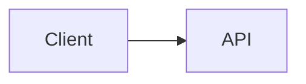

# Diagrams

## Mermaid

````markdown

````

A page with a diagram loads a pinned MermaidJS build from a CDN, coloured
from the page's style in light and dark mode: its background, text,
accent, rule, muted and warning colours. `--fragment` output loads nothing,
and leaves the diagram to a host that renders mermaid itself, as a Claude
Artifact does. The fence must be spelled ```` ```mermaid ````:
```` ```{.mermaid} ```` is an ordinary code block, and a `caption=` on a
mermaid fence is dropped. Click a diagram to expand it.

Use mermaid for graphs, sequences and flowcharts. Use a `fig` fence when
you need to place things yourself: panels side by side, stat tiles beside
boxes, a file tree.

## Structured figures

A ```` ```fig ```` fence is a figure you lay out yourself, written as YAML.
The examples below are in `yaml` fences so they show as source; in a real
document they go in a `fig` fence.

```yaml
caption: Request path
items:
  - box: Client
  - arrow: HTTP POST
  - group: Server
    items:
      - box: "`auth` middleware"
      - result: 200 OK
```

### Quote labels

Labels take inline Markdown (code spans, emphasis, links, badges, `§`
references) only when YAML reads them as a string. Quote a label that:

- starts with `` ` ``, `*`, `[`, `{`, `&`, `!`, `%`, `@`, `|` or `>`
- contains `: ` or ` #`

Unquoted, the first group fails to parse and the figure renders as a code
block with a YAML error, and ` #` starts a comment, so `box: Step #3 of 4`
silently renders "Step". An unquoted `null` or `~` is no value.

### Kinds

Every item is exactly one kind:

| Kind | Value | What it is |
|---|---|---|
| `box` | label | a labeled box |
| `arrow` | label, may be `""` | a connector; blank is decorative |
| `result` | label | an emphasized outcome bar |
| `rail` | label | a full-width accent rail |
| `stats` | list of `value`/`label`, plus optional `detail` | a row of stat tiles |
| `defs` | list of `term`/`def` | a term/definition grid |
| `group` | title, plus `items` | a labeled panel |
| `chain` | list of items | steps connected in sequence |
| `lanes` | list of lists | parallel stacks |
| `tree` | an indented block | a file or config hierarchy |
| `cols` | list of items | items side by side |
| `split` | list of exactly 2 items | two panels either side of a `boundary` |

A blank box is `box: ""`; a bare `box:` names no kind and is an error.

### Modifiers

| Modifier | On | What it does |
|---|---|---|
| `note` | `box`, `result`, `rail`, `group` | a quieter gloss beside the label |
| `accent` | `box`, `result`, `rail`, `group` | marks the item out from its siblings |
| `foot` | `group` | a line below the group's items |
| `boundary` | `split` | the label between the two panels |
| `weight` | a child of a `cols` layout or `cols` item | its share of the width, 1–12 |
| `items` | `group` | the group's contents |

A modifier anywhere else is an error. A panel that needs a title, an accent
or a footnote holds a `group`.

### Layout

The top-level `layout` is `rows` (the default), `cols` or `split`. `cols`
and `split` are also item kinds, so a layout can sit anywhere an item can:

```yaml
items:
  - rail: A request crosses one trust boundary
  - split:
      - group: Client
        items: [{box: Browser}]
      - group: Server
        items: [{box: Handler}]
    boundary: TLS
  - result: The response is signed
```

A figure whose only item is a `cols` or `split` item is an error; write
`layout: cols` or `layout: split` instead. Every panel draws a card,
except one holding an arrow.

`wide: true` at the top level lets the figure extend past the text column.
It has no effect inside a container, or in `--fragment` output that its
host places inside a box of its own rather than directly in `<body>`.

### Trees

A `tree` is an indented listing, one node per line:

```yaml
items:
  - tree: |
      src/
        * main.go -- the entry point
        util.go
      - vendor/ -- not ours
```

Indent with spaces; a tab is an error. ` -- ` splits a label from its note,
a leading `* ` accents a line and `- ` mutes it. Each needs its spaces, so
`*_test.go` stays literal; escape one with a backslash (`\--`) to keep it.

### Faults

A figure that does not parse or validate renders as a code block and warns,
naming the item and the fault. Line numbers count from the first line of
the fence body. The figure's caption is the `caption:` key; `caption=` on
the fence line warns.
